

  <a href="https://prisma-studios.pw"><picture><source media="(prefers-color-scheme: dark)" srcset="./assets/banner-dark.png"><source media="(prefers-color-scheme: light)" srcset="./assets/banner-light.png">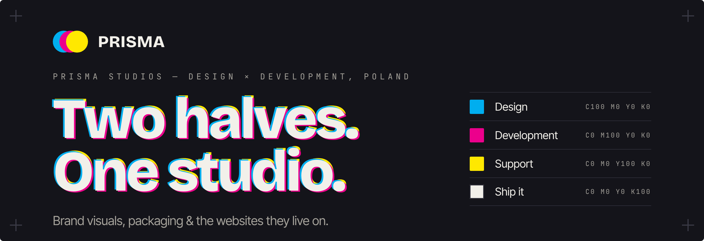</picture></a>

  I design and build things for the web — brand visuals, banners and packaging on one side, 
  websites and web apps on the other. One person, both halves of the job.

  <a href="https://prisma-studios.pw"><picture><source media="(prefers-color-scheme: dark)" srcset="./assets/btn-website-dark.png"><source media="(prefers-color-scheme: light)" srcset="./assets/btn-website-light.png">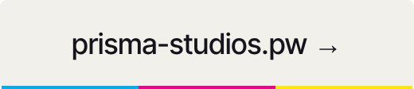</picture></a>
  &nbsp;
  <a href="https://www.behance.net/"><picture><source media="(prefers-color-scheme: dark)" srcset="./assets/btn-behance-dark.png"><source media="(prefers-color-scheme: light)" srcset="./assets/btn-behance-light.png">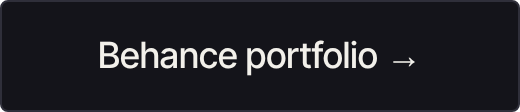</picture></a>
  &nbsp;
  <a href="https://prisma-studios.pw"><picture><source media="(prefers-color-scheme: dark)" srcset="./assets/btn-freelance-dark.png"><source media="(prefers-color-scheme: light)" srcset="./assets/btn-freelance-light.png">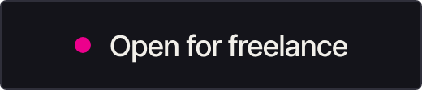</picture></a>

 

<picture><source media="(prefers-color-scheme: dark)" srcset="./assets/h-stack-dark.png"><source media="(prefers-color-scheme: light)" srcset="./assets/h-stack-light.png">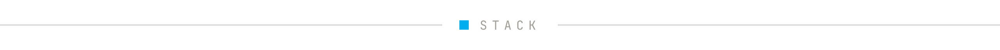</picture>

  <picture><source media="(prefers-color-scheme: dark)" srcset="./assets/stack-dark.png"><source media="(prefers-color-scheme: light)" srcset="./assets/stack-light.png">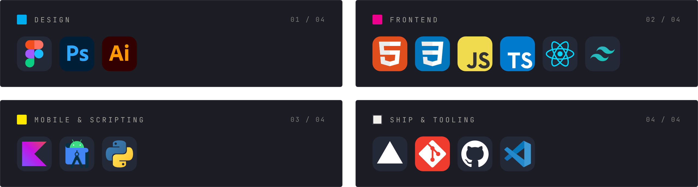</picture>

 

<picture><source media="(prefers-color-scheme: dark)" srcset="./assets/h-work-dark.png"><source media="(prefers-color-scheme: light)" srcset="./assets/h-work-light.png">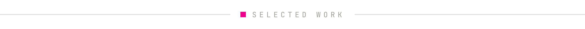</picture>

  <a href="https://blackjack-amber.vercel.app"><picture><source media="(prefers-color-scheme: dark)" srcset="./assets/card-webjack-dark.png"><source media="(prefers-color-scheme: light)" srcset="./assets/card-webjack-light.png">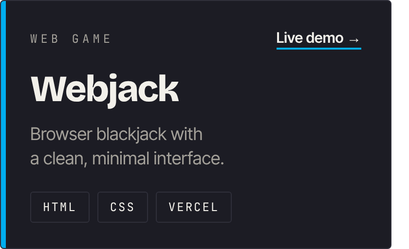</picture></a><a href="https://github.com/prisma-studios71/Opentaiment"><picture><source media="(prefers-color-scheme: dark)" srcset="./assets/card-opentaiment-dark.png"><source media="(prefers-color-scheme: light)" srcset="./assets/card-opentaiment-light.png">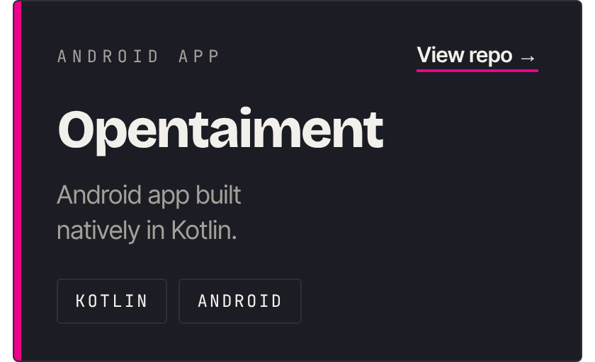</picture></a><a href="https://prisma-studios.pw"><picture><source media="(prefers-color-scheme: dark)" srcset="./assets/card-vantage-dark.png"><source media="(prefers-color-scheme: light)" srcset="./assets/card-vantage-light.png">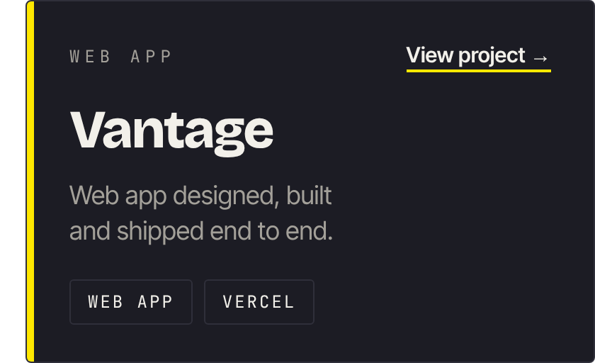</picture></a>

 

<picture><source media="(prefers-color-scheme: dark)" srcset="./assets/h-services-dark.png"><source media="(prefers-color-scheme: light)" srcset="./assets/h-services-light.png">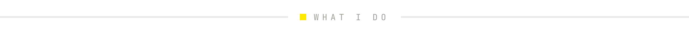</picture>

  <picture><source media="(prefers-color-scheme: dark)" srcset="./assets/services-dark.png"><source media="(prefers-color-scheme: light)" srcset="./assets/services-light.png">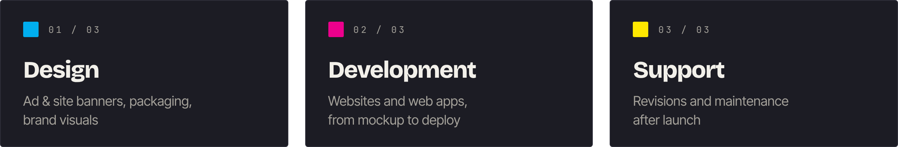</picture>

 

  Have a brand, product or idea that needs to look sharp online? 
  <a href="https://prisma-studios.pw"><b>Let's talk → prisma-studios.pw</b></a>

